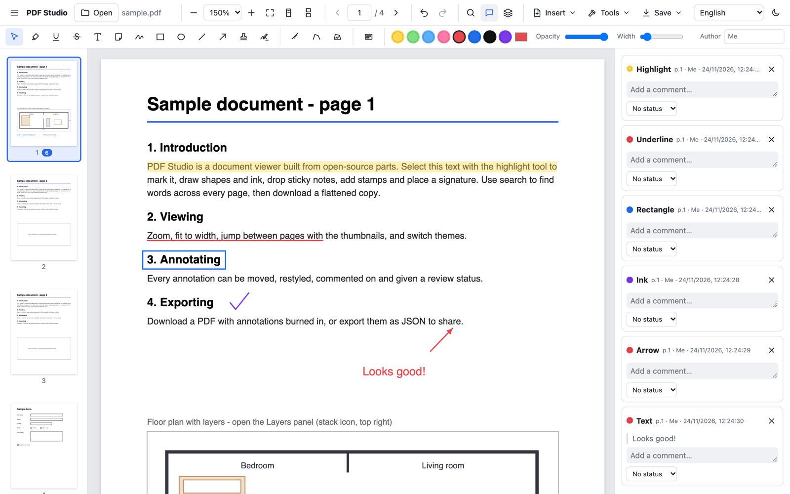

# PDF Studio

[](https://github.com/nandkishormewara/pdf-studio/actions/workflows/tests.yml)
[](https://nandkishormewara.github.io/pdf-studio/)
[](LICENSE)


An open-source PDF viewer and editor you can embed in your own apps — **web, iOS and Android** — plus an
optional server for Office files, OCR, redaction and digital signatures.

It is a free, licence-key-free alternative to commercial SDKs such as Apryse / PDFTron, built only from
permissively licensed parts: [PDF.js](https://github.com/mozilla/pdf.js) (Apache-2.0),
[pdf-lib](https://github.com/Hopding/pdf-lib) (MIT), Apple PDFKit and
[PdfBox-Android](https://github.com/TomRoush/PdfBox-Android) (Apache-2.0). It reads and writes XFDF the way
Acrobat and Apryse WebViewer do, so annotations saved by an existing PDFTron app keep opening.

**[Try the live demo →](https://nandkishormewara.github.io/pdf-studio/)** It runs entirely in your browser: your files never leave your device.



## What it does

- **View and search:** continuous scroll, zoom, thumbnails, dark mode, links, regex / whole-word search.
- **Annotate:** highlight, underline, strikeout, squiggly, text boxes, notes, ink, shapes, arrows, clouds,
  stamps and signatures, with comments, replies and review status.
- **Measure:** distance, perimeter and area, with scale and calibration.
- **Forms:** fill all common field types, import/export JSON, flatten.
- **Pages:** rotate, delete, reorder by drag, insert blank, merge PDFs, images to pages, extract pages.
- **Save and exchange:** PDF with **editable** annotations (Acrobat- and Chrome-compatible) or flattened,
  print, XFDF (incl. Apryse `<add>/<modify>/<delete>` commands) and JSON.
- **Any script:** Hindi and other non-Latin text in annotations and form fields.
- **Extract:** text, tables (to Excel or CSV), images and fonts.
- **Server (optional):** open Word / Excel / PowerPoint, OCR in 160+ languages, true redaction,
  PAdES sign and verify.

## Repository layout

| Folder | What it is |
|---|---|
| [`web/`](web) | Full web app plus the framework-free web SDK (`web/src/sdk`) |
| [`packages/react-viewer/`](packages/react-viewer) | `@pdf-studio/react-viewer`: a React component with a WebViewer-style API |
| [`mobile/ios/PDFStudioKit/`](mobile/ios) | Swift package (iOS 17+) on Apple PDFKit, with a SwiftUI viewer and a demo app |
| [`mobile/android/pdfstudio/`](mobile/android) | Android library (Kotlin, minSdk 24) with a Compose viewer and a demo app |
| [`server/`](server) | Optional FastAPI server: Office → PDF, OCR, redaction, signatures |
| [`deploy/`](deploy), [`scripts/`](scripts) | Ubuntu deployment, local start script, licence-notice generator |
| [`docs/`](docs/README.md) | Product, user, developer, server, mobile and migration guides |

## Quick start

### Web app

```bash
cd web
npm install
npm run dev
```

Open the URL Vite prints, then click **Try a sample document** or drop in a PDF or images.

### React component

```bash
cd packages/react-viewer
npm install
npm run build      # → dist/
```

```tsx
import { PdfWebViewer } from '@pdf-studio/react-viewer';

<PdfWebViewer
  documentUrl="/files/report.pdf"
  mode="edit"                       // or "view"
  initialXfdf={savedXfdf}           // optional: previously saved annotations
  onReady={(handle) => { /* handle.exportXfdf(), handle.exportAnnotatedPdf(), … */ }}
/>
```

### iOS (Swift Package Manager)

In Xcode choose **File → Add Package Dependencies…** and enter
`https://github.com/nandkishormewara/pdf-studio`, or in `Package.swift`:

```swift
.package(url: "https://github.com/nandkishormewara/pdf-studio", from: "1.0.0")
// target dependency: .product(name: "PDFStudioKit", package: "pdf-studio")
```

Then:

```swift
import PDFStudioKit

let doc = StudioDocument(data: pdfData, name: "document.pdf")!
try doc.mergeXFDF(savedXfdf)
PDFStudioViewer(document: doc)      // SwiftUI
```

### Android

Download `pdfstudio-release.aar` from the [latest release](https://github.com/nandkishormewara/pdf-studio/releases/latest),
put it in your app's `libs/` folder and add it with its dependencies (an AAR doesn't carry them):

```kotlin
dependencies {
    implementation(files("libs/pdfstudio-release.aar"))
    implementation("com.tom-roush:pdfbox-android:2.0.27.0")
    implementation("org.jetbrains.kotlinx:kotlinx-serialization-json:1.9.0")
    implementation(platform("androidx.compose:compose-bom:2025.12.00"))
    implementation("androidx.compose.ui:ui")
    implementation("androidx.compose.foundation:foundation")
    implementation("androidx.compose.material3:material3")
    implementation("androidx.activity:activity-compose:1.11.0")
}
```

Or include the `mobile/android/pdfstudio` module from source. Then:

```kotlin
PdfStudioViewer.open(context, uri, ViewerConfig(title = "Document", xfdfLayers = listOf(savedXfdf)))
```

More in [mobile/README.md](mobile/README.md).

### Server (optional)

```bash
brew install tesseract tesseract-lang && brew install --cask libreoffice   # macOS
cd server && ./run.sh                                                       # http://127.0.0.1:8787
```

Docker, configuration and certificates: [docs/server-and-deployment.md](docs/server-and-deployment.md).
`scripts/start-local.sh` runs the web app and the server together.

## Coming from Apryse / PDFTron?

[docs/migrating-from-pdftron.md](docs/migrating-from-pdftron.md) maps WebViewer, the PDFTron iOS and Android
SDK calls and the server features to their PDF Studio equivalents, and explains how existing XFDF keeps working.

## Tests

| Part | Command |
|---|---|
| Web app | `cd web && npm run lint && npm run build` |
| React component + shared web SDK checks | `cd packages/react-viewer && npm test` |
| iOS | `cd mobile/ios/PDFStudioKit && swift test` |
| Android | `cd mobile/android && ./gradlew :pdfstudio:testDebugUnitTest` |
| Server | `cd server && python -m pytest` |

All of them run on every push and pull request ([Tests workflow](.github/workflows/tests.yml)).

## Contributing

Bug reports, fixes and features are welcome: see [CONTRIBUTING.md](CONTRIBUTING.md). Report security problems
privately as described in [SECURITY.md](SECURITY.md). Release notes are in [CHANGELOG.md](CHANGELOG.md).

## Licence

PDF Studio is released under the [MIT licence](LICENSE). Third-party components keep their own licences;
see the `THIRD-PARTY-NOTICES.txt` files in `web/public`, `server`, and the mobile SDKs.

PDF Studio is not affiliated with Apryse, PDFTron or Adobe. Those names are used only to describe compatibility.
