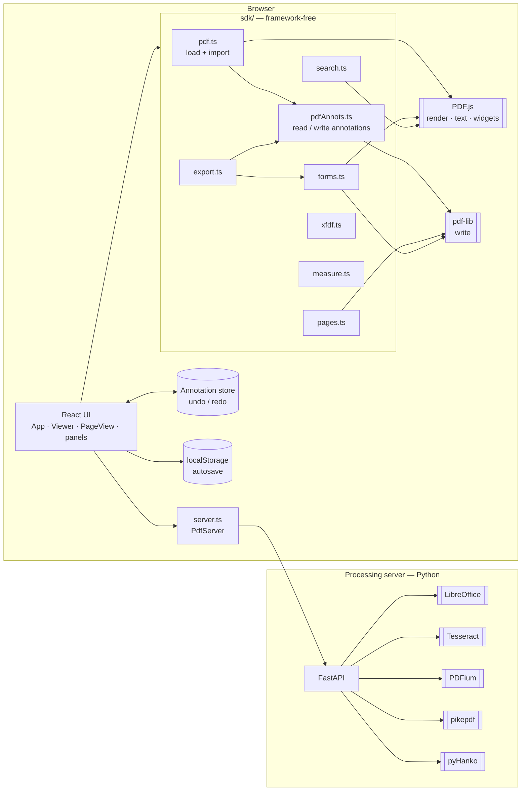
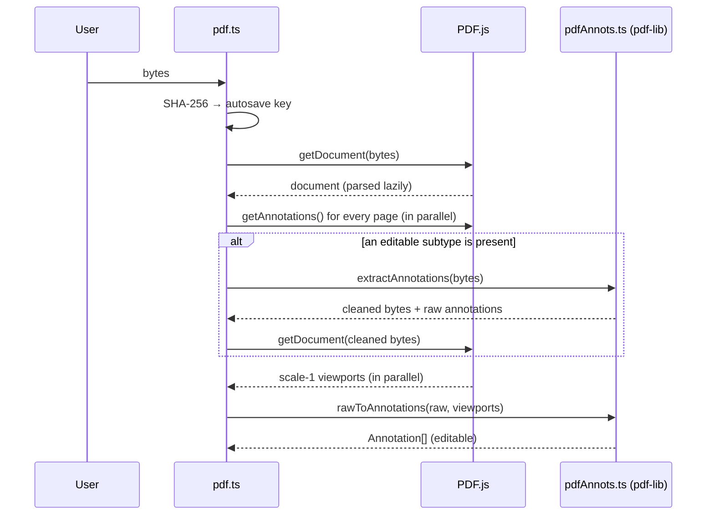

# Developer guide

**For engineers and contributors.** Setup, code map, architecture, file formats, the SDK API and how to extend PDF Studio. Mobile builds are in [Mobile SDKs](mobile-sdks.md), the server API in [API testing](api-testing.md), replacing PDFTron / Apryse in [Migrating from PDFTron](migrating-from-pdftron.md).

## Setup

Requirements: Node.js 22+ and npm.

```bash
cd web
npm install
npm run dev        # http://localhost:5173
npm run build      # type-check + production bundle in web/dist
npm run lint       # oxlint
npm run i18n:check # lists screen texts that are not wrapped in t() or not translated (--strict fails the run)
```

Optional server features (conversion, OCR, redaction, signatures) need the processing server:

```bash
cd server
./run.sh            # http://127.0.0.1:8787, see docs/server-and-deployment.md
```

The production build is a static site (`web/dist`). Host it on any static host or CDN, or copy it
into another app's public folder. No server is needed.

## Project layout

```
pdf-studio/
├── README.md
├── deploy/                  Ubuntu test-server setup and deploy script (docs/server-and-deployment.md)
├── docs/                    these documents and the Postman collection
├── mobile/                  iOS and Android SDKs (docs/mobile-sdks.md)
├── packages/react-viewer/   @pdf-studio/react-viewer, WebViewer-style React component (docs/migrating-from-pdftron.md)
├── scripts/                 start-local.sh, gen_third_party_notices.py
├── server/                  Python processing server (docs/server-and-deployment.md)
│   ├── app/
│   │   ├── main.py          FastAPI routes, limits, CORS
│   │   ├── config.py        Environment settings, tool discovery
│   │   ├── convert.py       LibreOffice conversion
│   │   ├── render.py        PDFium rendering in unrotated user space
│   │   ├── ocr.py           Tesseract text layer + placement
│   │   ├── redact.py        True redaction, exact text targets, sanitising
│   │   ├── signing.py       pyHanko PAdES signing, verification, dev certificate
│   │   ├── optimize.py      Linearize, recompress, downsample images
│   │   ├── extract.py       Text with PDFium glyph boxes, tables, images, fonts (pikepdf); JSON / ZIP / TXT / XLSX
│   │   ├── tables.py        Table detection (same steps as web sdk/tables.ts), ruling lines from PDFium paths, CSV / XLSX
│   │   └── reading_order.py Reading order (same steps as web sdk/readingOrder.ts)
│   ├── tests/               pytest suite (29 tests)
│   ├── Dockerfile, run.sh, requirements*.txt
└── web/
    ├── index.html
    ├── scripts/
    │   ├── i18n-check.mjs   Finds untranslated screen texts (TypeScript AST)
    │   └── translations.py  English → Hindi / Arabic / Malay table; writes src/i18n/{hi,ar,ms}.ts
    └── src/
        ├── main.tsx         React entry (wraps App in I18nProvider)
        ├── i18n/            index.tsx (useT, useLanguage, I18nProvider), hi.ts, ar.ts, ms.ts (generated)
        ├── App.tsx          Shell: toolbars, menus, panels, document lifecycle, export/import
        ├── App.css          Component styles (light/dark tokens in index.css)
        ├── state/
        │   └── store.ts     Annotation store with undo/redo (useReducer)
        ├── components/
        │   ├── Viewer.tsx         Scroll container, layouts (continuous / single / spread, cover, RTL), lazy visibility, zoom anchoring
        │   ├── PageView.tsx       One page: canvas, text layer, forms, hits, annotation SVG, tool interaction
        │   ├── AnnotationShape.tsx  SVG rendering of one annotation (pure)
        │   ├── FormLayer.tsx      HTML form controls + link hot-spots
        │   ├── Thumbnails.tsx     Page list + page organiser (rotate, delete, insert, extract, drag reorder)
        │   ├── SearchPanel.tsx    Search UI
        │   ├── CommentsPanel.tsx  Annotation list, comments, review status
        │   ├── ExtractDialog.tsx  Extract text / tables / images / fonts: options, progress, single file or ZIP
        │   ├── LayersPanel.tsx    Layer list (optional content) with show / hide, headings, radio groups
        │   ├── RichTextEditor.tsx In-place text-box editor with B / I / U / colour
        │   ├── SignatureDialog.tsx Draw/type signature pad
        │   ├── ServerDialogs.tsx  OCR, redaction, digital signing and verification dialogs
        │   ├── Menu.tsx           Menu button (keyboard: ↑ ↓ Home End Esc)
        │   ├── Icon.tsx
        └── sdk/                   Framework-free core (no React imports)
            ├── types.ts           Annotation, FormWidget, SearchHit… data model
            ├── pdf.ts             loadPdf(), streamPdf() (range loading), createSamplePdf()
            ├── pdfAnnots.ts       Appearance streams, writeAnnotations(), extractAnnotations()
            ├── export.ts          exportPdf(), JSON helpers, download()
            ├── forms.ts           readPageInteractive(), collectFormData(), applyFormValues()
            ├── pages.ts           rotate/delete/move/insert/extract page operations
            ├── xfdf.ts            toXfdf(), fromXfdf()
            ├── search.ts          searchDocument()
            ├── measure.ts         Scale maths, labels, calibration
            ├── geometry.ts        Rect/point helpers, arrow heads, ellipse polygons
            ├── extract.ts         Text (lines, words, boxes, fonts), ruling lines, tables, images (decoded, placement), fonts (pdf-lib), page ranges
            ├── tables.ts          Table detection from words and ruling lines (lattice and stream); no pdf.js
            ├── readingOrder.ts    Reading order: split lines at column gaps and rows, sections, Breuel order, table rows
            ├── xlsx.ts            Minimal Excel writer (inline strings, merged cells) on top of zip.ts
            ├── zip.ts             Minimal stored ZIP writer (UTF-8 names, CRC-32)
            ├── layers.ts          Optional content: readLayers(), visibility state, writeDefaultLayerState()
            ├── richtext.ts        TextRun model; editor HTML and XHTML (/RC, contents-richtext) in and out
            ├── textImage.ts       Browser-shaped text → PNG for non-Latin export
            └── server.ts          Client for the processing server (PdfServer)
```

## SDK reference

### Loading

```ts
import { loadPdf } from './sdk/pdf';

const doc = await loadPdf(bytes, 'file.pdf', (retry) => prompt(retry ? 'Wrong password' : 'Password?'));
doc.pdf          // PDFDocumentProxy (PDF.js)
doc.bytes        // the document without the annotations that were imported
doc.imported     // Annotation[] found in the file, now editable
doc.viewports    // scale-1 viewports, one per page (coordinate conversion)
doc.pageSizes    // { width, height } per page, in page units
doc.key          // SHA-256 of the input bytes

// Large file from a URL: shows pages while the rest downloads
const s = await streamPdf(url, askPassword, name, (fraction) => setProgress(fraction));
s.pdf, s.viewports           // usable at once
const full = await s.complete; // whole file; then loadPdf(full, …) for annotations, saving, page operations
```

### Exporting

```ts
import { exportPdf } from './sdk/export';

const { bytes, warnings } = await exportPdf(doc.bytes, doc.viewports, annotations, {
  annotations: 'editable',   // or 'flatten'
  formValues: { 'applicant.name': 'Priya' },  // only changed fields
  flattenForms: false,
});
```

### Exchange formats

```ts
import { toXfdf, fromXfdf } from './sdk/xfdf';
import { annotationsToJson, annotationsFromJson } from './sdk/export';

const xml = toXfdf(annotations, doc.viewports, formValues);
const { annotations, fields } = fromXfdf(xml, doc.viewports);
```

### Forms

```ts
import { readPageInteractive, collectFormData } from './sdk/forms';

const { widgets, links } = await readPageInteractive(doc.pdf, page, pageIndex, viewport);
const allValues = await collectFormData(doc.pdf, doc.viewports, editedValues);
```

#### Marks saved by Apryse WebViewer

- **Fringe:** Apryse writes XFDF `fringe` as left, bottom, right, top. PDF `/RD` stays left, top, right, bottom.
- **Same mark twice:** `mergeXfdf` (web), `Xfdf.merge` (Android) and `StudioDocument.mergeXFDF` (iOS) replace an
  in-file mark by id (`/NM`), or, for unnamed marks, by type, page, text and box within 1.5 pt.
- **Wrapping:** free text wraps between words at the box width (`wrapRuns`, `RichText.wrap`); a word wider than the
  box stays whole. iOS draws free text itself (`StudioDrawnAnnotation`, created as `.freeText`); Android draws it in
  Liberation Sans from the PdfBox-Android assets, measured at 100 px.
- **Highlights** multiply with the page. On Android the page bitmap is drawn on the same canvas as the marks
  (`BlendMode.MULTIPLY`; darken before Android 10).

### Page operations

Every function returns `{ bytes, annotations }`. Reload the bytes with `loadPdf` afterwards.

```ts
rotatePages(bytes, [0], /* clockwise */ true, doc.pageSizes, annotations)
deletePages(bytes, [2, 3], annotations)
movePage(bytes, from, to, annotations)
insertBlankPage(bytes, at, size, annotations)
insertPdf(bytes, otherBytes, at, annotations)
insertImages(bytes | null, files, at, annotations)   // null → new document
extractPages(bytes, [0], annotations)
```

### Search

```ts
const hits = await searchDocument(doc.pdf, doc.viewports, 'invoice', { caseSensitive: false, wholeWord: true, regex: false }, { cancelled: false });
// hits[i] = { page, rects: Rect[] (page units), context }
```

### Server client

```ts
import { PdfServer } from './sdk/server';

const server = new PdfServer('http://localhost:8787');
const health = await server.health();
const { bytes } = await server.convert(file);
const { bytes: searchable, report } = await server.ocr(pdfBytes, ['eng', 'hin']);
const { bytes: redacted } = await server.redact(pdfBytes, [{ page: 0, rects: [[x1, y1, x2, y2]] }], { sanitize: true });
const { bytes: signed } = await server.sign(pdfBytes, { reason: 'Approved', page: 0, box: [400, 40, 580, 110] });
const { bytes: fast, report: sizes } = await server.optimize(pdfBytes, { maxImageDpi: 150 });
const checks = await server.verify(signedBytes);
```

Coordinates sent to the server are PDF user space. Convert from page units with
`viewport.convertToPdfPoint` (see `toPdfBox` in `App.tsx`).

## How-to: add a new annotation type

1. **Model:** add the kind to `AnnotationKind` in `sdk/types.ts` and decide which geometry field
   it uses (`rect`, `rects`, `points` or `paths`).
2. **Screen:** render it in `components/AnnotationShape.tsx` (page units, SVG). Add a transparent
   wide stroke for easy hit-testing if it's thin.
3. **Creation:** handle it in `PageView.buildFromDrag` (drag) or the `poly` flow (click-to-add-points).
4. **Toolbar:** add it to `TOOLS` in `App.tsx`, and add an icon path in `Icon.tsx`.
5. **PDF output:** add a case in `buildAppearance` (`sdk/pdfAnnots.ts`). Map it to a PDF subtype in
   `SUBTYPE`, and add the standard keys in `annotationDict`.
6. **Import:** if third-party files use that subtype, add it to `IMPORTABLE` and `rawToAnnotations`.
7. **Exchange:** map it in `TAG` and in the `fromXfdf` switch in `sdk/xfdf.ts`.
8. **Labels:** add it to `LABELS` in `CommentsPanel.tsx`.
9. **Translations:** add any new screen text to `web/scripts/translations.py`, run it, then `npm run i18n:check -- --strict`.
10. **Docs:** update the [user guide](user-guide.md), the feature table in [product and features](product-and-features.md) and the file-format section below.

TypeScript's exhaustive `Record<AnnotationKind, …>` maps will point out most of the places you missed.

## Embedding in another app

The UI is a single React tree (`<App />`). For now, embed the built site in an `<iframe>`, or
import `App` in another Vite/React project. A packaged `@pdf-studio/web` component with props
(document URL, user name, read-only mode, callbacks on save) is planned. For a ready-made React component, use
`packages/react-viewer` (`@pdf-studio/react-viewer`), which has a WebViewer-style API ([migrating from PDFTron](migrating-from-pdftron.md#web-webviewer--pdftronwebviewer)).

## Tests

| What | Command | Count |
|---|---|---|
| Web type-check, lint, translations | `cd web && npx tsc -b && npm run lint && npm run i18n:check -- --strict` | — |
| Server | `cd server && .venv/bin/python -m pytest -q` | 36 |
| iOS SDK | `cd mobile/ios/PDFStudioKit && swift test` | 35 |
| Android SDK | `cd mobile/android && ./gradlew :pdfstudio:testDebugUnitTest` (+ `connectedDebugAndroidTest` on a device) | 31 unit + 12 device |
| React viewer package (also runs the web SDK's table and reading-order tests) | `cd packages/react-viewer && npm test` | 49 |
| Server API | [API testing](api-testing.md), Postman collection | 29 requests |

The web app has no automated UI tests yet: the shared fixtures in `mobile/shared/` are checked by the iOS, Android and React viewer package tests, and the web UI by hand. Adding Playwright tests for the main flows is a good next step.

## Conventions

- `sdk/` must not import React or touch the DOM, except for `textImage.ts` and `download()`,
  which need a canvas or anchor.
- Store geometry in page units only. Convert at the edges (screen with `× scale`, PDF with the viewport).
- Prefer adding a case to an existing switch over new parallel code paths, so on-screen,
  flattened and editable output stay identical.
- **Every screen text goes through `t()`** (`const t = useT()`), as a whole sentence with `{placeholders}`:
  `t('Page {n}', { n })`, never `t('Page') + n`. Translators need the full sentence; Hindi and Arabic word order differ.
- **Layout uses logical CSS** (`margin-inline-start`, `inset-inline-end`, `text-align: start`) so the Arabic screen
  mirrors by itself. PDF pages, thumbnails and the signature pad set `direction: ltr` and must not mirror.
- **Accessibility:** every control has a visible label or `aria-label`; colours come from the theme tokens in
  `index.css` (text on `--accent` / `--danger` uses `--on-accent` / `--on-danger`); new interactive elements must work
  with the keyboard. Check with axe-core.
- **Untrusted content:** annotation text, colours and XFDF come from other people's files. Escape text before it
  reaches HTML, and pass colours through `safeColor` (only `#rrggbb`).

## Architecture

### Overview



The `sdk/` folder has no React dependency, so the same logic can back other front-ends.
The iOS and Android SDKs share the **annotation JSON model and coordinate system**, not the code ([Mobile SDKs](mobile-sdks.md)).

### Coordinate system

All annotation geometry is stored in **page units**: the PDF.js viewport at scale 1, origin at the
**top-left of the page as displayed** (page `/Rotate` already applied), 1 unit = 1 PDF point (1/72 in).

- Screen pixels = page units × zoom.
- Converting to PDF user space (bottom-left origin, unrotated) uses
  `viewport.convertToPdfPoint(x, y)`; the reverse uses `convertToViewportPoint`.
- Every exporter (flattened PDF, editable annotations, XFDF) goes through those two functions, so
  rotated pages and pages with offset crop boxes are handled in one place.

When a page is rotated in the editor, `pages.ts` transforms annotation geometry
(`(x, y) → (H − y, x)` for 90° clockwise). Box content such as text, stamps and signatures keeps
its size and stays upright.

### Rendering layers (per page)

```
┌ .page ───────────────────────────────────────────┐
│ canvas          PDF.js raster (forms excluded)    │  z 0
│ .textLayer      transparent selectable text       │  z 1
│ .form-layer     HTML form controls + link spots   │  z 2
│ .hit-layer      search matches                    │  z 2
│ svg.annot-layer annotations, selection, previews  │  z 3
│ .rte            in-place rich-text editor         │  z 4
└───────────────────────────────────────────────────┘
```

Pointer routing depends on the active tool:

- **Select**: the SVG ignores the pointer except over annotations, so text selection, form fields
  and links underneath keep working.
- **Text markup**: the SVG is inert. The browser's text selection is turned into rectangles.
- **Drawing tools**: the SVG captures the pointer, with a crosshair cursor.

Pages render only when within 1.5 screens of the viewport (IntersectionObserver), and are released
when they scroll away. This keeps memory flat on long documents. Rendering goes to an off-screen
canvas first, so zooming doesn't flash.

### Load pipeline



PDF.js opens the file first because it parses lazily. A large file with no editable annotations is never fully parsed by pdf-lib.

`extractAnnotations` removes the annotations we can edit (Highlight, Underline, StrikeOut, Square,
Circle, Line, Ink, FreeText, Text, PolyLine, Polygon, plus anything carrying our `/PDFStudio` key)
and their popups. That way they are drawn by our editor instead of being baked into the page image.
Links, widgets, file attachments and third-party stamps are left alone.

When an annotation has our `/PDFStudio` JSON and its `/M` date still matches `/PDFStudioM`, the JSON
is used, so the round trip is lossless. If another app edited it, the date differs and we fall back
to reading the standard PDF keys (for FreeText this includes `/RC` rich text).

Encrypted files skip extraction and render as they are.

### Layers (optional content)

`readLayers(pdf)` turns pdf.js's `getOptionalContentConfig()` into panel rows in the document's `/Order`: layers,
headings (labelled nested arrays) and radio-group membership. The same `OptionalContentConfig` object is passed to every
`page.render({ optionalContentConfigPromise })` (pages and thumbnails). Switching a layer mutates it with
`setVisibility`, and `config.getHash()` goes into React state as `layerHash`, so exactly the affected canvases re-render.

- **Remembered** per document version in `pdfstudio.layers.<sha256>` (`{groupId: visible}`); carried over **by layer
  name** when a document reloads with new bytes (page operations, a finished link download).
- **Saved into files:** `exportPdf(…, { layers })` calls `writeDefaultLayerState`, which sets `/OCProperties /D` to
  `/BaseState /ON` with explicit `/ON` and `/OFF` arrays and removes `/AS` (so readers don't switch layers again on view
  or print). Print always passes the current state; downloads only with *Save these choices…*. Group ids (`"12R"`)
  are object references in `doc.bytes`, the same bytes `exportPdf` loads.
- **Limits of the pdf.js layer list:** an unlabelled nested array (Acrobat's "layer followed by its sub-layers") and
  layers missing from `/Order` both arrive in a `{name: null}` bucket; they are listed flat. `/Locked` isn't exposed.
  The text layer and search don't follow layer visibility.

### Extraction

`sdk/extract.ts` works on a separate pdf.js copy of the document opened with `fontExtraProperties: true`
(`openForExtraction`): only then do pdf.js font objects keep their real names. Viewing keeps the cheaper default.

- **Text:** `page.getTextContent()` items are runs with a text-space matrix and width. Each run's box is its baseline
  vector × width and its up vector × the font's ascent/descent, mapped through the scale-1 viewport, so rotated pages
  and crop boxes come out in page units. Runs join into a line while the baseline and direction stay the same; a gap of
  more than 0.15 em adds a space; `hasEOL` ends a line. Words split on whitespace with boxes proportional to character
  count inside a run. Control characters (broken ToUnicode maps) are dropped. Font names come from `setFont` operators →
  `commonObjs`.
- **Images:** the operator list is walked keeping the CTM (`save` / `restore` / `transform` / form XObjects). Each
  `paintImageXObject` / inline / repeat op is placed by mapping the unit square through the CTM. The decoded image
  (`bitmap`, or `data` with `kind` 1/2/3) is drawn to a canvas and encoded. Objects are deduplicated by pdf.js id; image
  masks (stencils) are skipped.
- **Fonts:** pdf-lib walks every page's `/Resources /Font`, recursing into form XObjects. Type0 fonts are read
  through `DescendantFonts`. `FontFile` / `FontFile2` / `FontFile3` (Type1C, CIDFontType0C, OpenType) are decoded with
  `decodePDFRawStream`.
- **Tables:** `pageRulings` walks the operator list like images do and reads `constructPath` (pdf.js 5+: `[paint op,
  [path data], bbox]`, path data as `DrawOPS` codes). Stroked paths give their straight segments; filled boxes thinner
  than 3 pt become one line (office suites draw borders that way); clipping paths and curves are skipped.
  `tables.ts` `detectTables(page, words, segments)` then runs two passes:
  - *Lattice:* horizontal and vertical lines are snapped (3 pt) and joined; lines that cross belong to one table
    (union-find). The distinct line positions are the grid. A base cell joins its neighbour when the line between
    them is missing at the middle of their shared edge, which gives merged cells. Words go to the cell holding their
    centre; empty grids are dropped.
  - *Stream* (remaining words): words are grouped into rows by vertical centre and split into chunks at gaps wider
    than 0.9 × the row's word height. A block ends at a vertical gap over 1.2 line heights. Column bands come from the
    rows with the most common chunk count. A one-chunk row crossing two bands is prose and splits the block. A table
    needs 3 rows with ≥ 2 chunks and 2 bands; with exactly 2 bands the median chunk must be under 30 % of the width,
    so two-column running text is rejected.
  `server/app/tables.py` is the same algorithm with the same constants. `mobile/shared/tables/tables-page.json`
  (words and lines of `tables_pdf()` in `server/tests/conftest.py`, made by `server/tests/make_tables_fixture.py`) is
  checked by both test suites, so the two can't drift apart. Exports: `tablesToXlsx` (sheet per table, `mergeCells`;
  inline strings, so `=…` never runs), `tableToCsv`, `tablesToJson` (adds `grid`).
- **Reading order** (`readingOrder.ts`; `extractText(…, order = 'reading')` is the default):
  1. `splitAtGaps` cuts each line where a word no longer overlaps the row so far by half its height (PDFKit returns
     several rows of a column as one line) and, within a row, at gaps over `COLUMN_GAP` × word height (files that draw
     a left-column line and a right-column line as one).
  2. A horizontal band of empty space across the page taller than `SECTION_GAP` (1.5) line heights ends a section;
     sections are read top to bottom. Without this, a heading under the first of three columns would be read before
     the second column.
  3. Within a section, Breuel's order (2003): a before b if they overlap horizontally and a is higher, or a is
     entirely left of b and no piece vertically between them crosses the gap between them. Kahn's topological sort
     takes the highest free piece first (then the leftmost); a cycle takes the highest remaining piece. Right-to-left
     pages (`isRtl`: most letters Hebrew or Arabic script) mirror x.
  4. Pieces inside a detected table go to the cell holding their centre and come out as the table's rows, cells
     joined by `\t` as the grid has them.
  `inReadingOrder` runs table detection first (it reuses `pageRulings`). Server `reading_order.py`, Android
  `ReadingOrder.kt` + `StreamTables.kt` and iOS `ReadingOrder.swift` + `StreamTables.swift` are the same algorithm;
  the devices have no ruling lines, so they pass only borderless tables. `mobile/shared/reading-order/cases.json`
  (newsletter, tables page, right-to-left, PDFKit-style merged rows; made by
  `server/tests/make_reading_order_fixture.py`, with `columns.pdf` for the device tests) is run by all four suites, and
  `tables-page.json` `expectedWithoutLines` checks the device table detection. Swift's `sorted` is not stable, so
  the iOS code sorts with an index tie-break to match the others.
- **iOS character boxes:** `TextExtraction.swift` takes each character's box from `page.selection(for:)`, not
  `characterBounds(at:)`, whose index drifts from `page.string` after the spaces and line breaks PDFKit inserts
  (one character off on the next line, then two). Before 3 Nov 2026 iOS word boxes on multi-line pages were shifted.
- **Output:** `textToPlain` / `textToJson` / `textToCsv` (BOM; cells starting with `= + - @` are prefixed with `'` so
  Excel won't run them) and `makeZip` (stored, UTF-8 names).
- **Server and mobile:** `server/app/extract.py` (PDFium per-character boxes; same `_Geometry` mapping as pdf.js's
  viewport), Android `TextLines.kt` / `TextExport`, iOS `TextExtraction.swift`. All write the same
  `pages → lines → words` JSON with `{x, y, w, h}` boxes. The rotated-page cases are checked in each test suite.

### Opening from a URL (range loading)

`streamPdf(url)` calls `getDocument({ url, rangeChunkSize: 256 KB, disableAutoFetch: true, disableStream: true })`.
PDF.js then requests only the byte ranges it needs for the pages being drawn. The app shows that document at once,
marked `partial` (its `bytes` and `original` are empty). `pdf.getData()` downloads the rest in the background, with
progress from `onProgress`. When it completes, the app runs the normal `loadPdf` on the full bytes and swaps the
document in place, keeping the view and any annotations drawn meanwhile. Until then, anything that needs the bytes
(saving, page operations, server tools) shows *still downloading* instead of running (`stillLoading()` in `App.tsx`).

`?file=` links are accepted from the app's own origin and from `VITE_PDFSTUDIO_FILE_ORIGINS`. Accepting any URL would
let a crafted link show a look-alike document under the organisation's address.

### Export pipeline

`export.ts → exportPdf(bytes, viewports, annotations, options)`:

1. Load the cleaned bytes with pdf-lib.
2. **Forms:** write only the values the user changed, then regenerate appearances field by field.
   Fields the standard font can't draw (e.g. Hindi) set `/NeedAppearances` so viewers draw them.
   Flatten if requested and possible.
3. **Annotations:** `pdfAnnots.writeAnnotations`. For each annotation it builds an **appearance
   stream** (Form XObject, BBox in PDF space, ExtGState for opacity and multiply blending):
   - `editable` → wraps it in a real `/Annot` with standard keys (QuadPoints, L/LE, InkList,
     Vertices, DA, IT…) plus `/PDFStudio` JSON, and adds it to the page's `/Annots`.
   - `flatten` → draws the same XObject into the page content (`q /Name Do Q`).
4. Save with `updateFieldAppearances: false`, since appearances were handled in step 2.

Because both modes share one appearance generator, flattened, editable and on-screen output look
the same.

### Non-Latin text

The standard PDF fonts only cover WinAnsi (Latin-1). For other text in text boxes and stamps:

- **Shaped text (`unicodeText.ts`):** when a `TextShaper` is plugged in with `setTextShaper`, each line goes through a
  simple bidi pass (UAX #9 for one line: base direction from the first strong character, European/Arabic numbers,
  neutrals, run reordering, bracket mirroring in reversed Helvetica runs; explicit embeddings/isolates and bracket
  pairing are not handled) and is split into Latin runs (Helvetica) and runs per shaped script (Devanagari, Arabic,
  Hebrew). Shaped runs are written as real text in an embedded TrueType font (Type0 / CIDFontType2, Identity-H, with
  a CIDToGIDMap): each glyph-and-text pair gets its own character code, so the ToUnicode map says exactly what each
  drawn glyph reads as. A run's glyphs go in one `TJ`. Left-to-right runs also carry `/ActualText`; right-to-left
  runs carry their text in visual order and no ActualText (readers reverse RTL themselves). Glyphs that carry no text
  of their own (Arabic dots, harakat, matras) are drawn as vector outlines; combining marks travel on a zero-width
  carrier glyph. PDF.js, PDFium and Apple PDFKit read the text back.
- **Fonts:** embedded once per document at the end of `writeAnnotations`, subset by `ttfSubset.ts` (glyph ids kept;
  only `head`, `hhea`, `hmtx`, `maxp`, `loca`, `glyf`, `post` v3, `OS/2`, plus `cvt`/`fpgm`/`prep` when present).
  `writeAnnotations(…, { subsetFonts: false })` embeds the whole file. A short Hindi note adds about 5 KB.
- **The web app's shaper (`hbShaper.ts`, registered in `main.tsx`):**
  `harfBuzzShaper({ devanagari, arabic, hebrew: { regular, bold, name } }, load?)` over HarfBuzz (harfbuzzjs, MIT)
  and Noto Sans Devanagari, Arabic and Hebrew (OFL). The wasm loads the first time a mark with non-Latin text is
  saved, and each script's fonts only when that script is first saved. The first script listed also writes
  punctuation Helvetica lacks (—, ₹) on lines with no other script. The React viewer package registers no shaper,
  so its output is unchanged unless the host app calls `setTextShaper`.
- **Fallback:** without a shaper, or for scripts it doesn't cover (CJK, emoji), the text is rendered by the browser
  onto a 4×-resolution PNG and embedded as an image, as before.

#### Rich text

A text box may carry `richText: TextRun[]` (`{text, bold?, italic?, underline?, color?}`; lines split on `\n`).
`text` always holds the plain text, so tools that ignore rich text still work.

- **Appearance:** Latin runs are drawn as real text in Helvetica, Helvetica-Bold, -Oblique and -BoldOblique, with
  underlines as strokes. Non-Latin runs are shaped as above (bold uses the bold font; italic has no Devanagari face
  and is drawn upright). If the shaper can't cover a run, the whole box becomes one image (`renderRichTextImage`).
- **PDF:** `/RC` holds an XHTML body (`<p><span style="font-weight:bold;color:#…">`) in the form Acrobat and Apryse
  write; `/Contents` holds the plain text. On import `/RC` is parsed back; colours equal to the box colour are dropped.
- **XFDF:** the same XHTML body inside `<contents-richtext>`, next to `<contents>`.
- **Editor:** `RichTextEditor.tsx` uses a `contentEditable` element with the browser's editing commands. The HTML
  comes from `runsToHtml` (text escaped, colours through `safeColor`) and is read back with `htmlToRuns`, which keeps
  only bold, italic, underline and colour.

### Page operations

`pages.ts` functions take the current bytes and annotations and return
`{ bytes, annotations }`. The app then reloads the document through the normal load pipeline:

| Operation | Implementation |
|---|---|
| Rotate | `page.setRotation`, transform annotation geometry |
| Delete | `removePage`, drop and re-index annotations |
| Reorder | `removePage` + `insertPage` of the same page object (in place, so AcroForm widgets stay linked) |
| Insert blank / PDF / images | `insertPage` / `copyPages` / `embedJpg`·`embedPng`, shift indices |
| Extract | `copyPages` into a new document |

### Persistence

| Key | Value |
|---|---|
| `pdfstudio.annots.<sha256>` | Annotation JSON for that exact document version |
| `pdfstudio.form.<sha256>` | Edited form values |
| `pdfstudio.signature` | Last signature PNG |
| `pdfstudio.scale`, `.theme`, `.author`, `.lang`, `.layout`, `.rtlPages`, `.cover`, `.server` | Preferences |

The key is a hash of the opened bytes, so two different files never share annotations. After a page
operation the document has new bytes and so gets a new key. Documents still downloading from a link are
not autosaved until the full file (and so its key) is known.

### Server features

The server is stateless: each request is processed in a temporary directory and the result is
returned. The web app treats its output like any other document:

| Action | What the web app sends | What happens after |
|---|---|---|
| Open Office file | the original file | the returned PDF is opened |
| OCR | `doc.bytes` (the document without editor annotations) | reloaded; editor annotations are kept as they are |
| Redact | an *editable* export of the current state without the redaction marks, plus regions and exact text targets | reloaded; surviving annotations are re-imported from the PDF, form values are now in the file |
| Sign | `doc.original` if nothing changed (keeps existing signatures valid), otherwise an editable export | downloaded and opened; the signed banner appears |
| Verify | `doc.original` | results dialog |
| Optimise | an *editable* export of the current state (refused if the document is signed) | downloaded as *name-web.pdf* |

Redaction and OCR share `render.render_unrotated`. Pages are rendered with the page's `/Rotate`
undone, so pixel coordinates map directly onto PDF user space. The OCR text layer is then placed
with an explicit matrix. (pikepdf's `add_overlay` would apply the page rotation a second time.)

### Performance notes

- One worker thread (PDF.js) does parsing and rasterising, so the UI stays responsive.
- Page text is fetched once per page and cached per document for search (`WeakMap`).
- Thumbnails render lazily at 2× their display size.
- Page sizes and annotation checks are fetched for all pages in parallel when a document opens.
- Large exports run pdf-lib on the main thread. Moving them into a Web Worker is a planned improvement.

## File formats

### Annotation JSON (PDF Studio native)

Lossless. Used for autosave, **Save ▸ Export JSON**, and inside PDFs (`/PDFStudio` key).

```json
{
  "format": "pdf-studio-annotations",
  "version": 2,
  "file": "sample.pdf",
  "annotations": [
    {
      "id": "k3j9x2ab0f1c",
      "page": 0,
      "kind": "highlight",
      "color": "#ffd84d",
      "opacity": 0.4,
      "strokeWidth": 0,
      "rects": [{ "x": 56, "y": 98.4, "w": 312.5, "h": 13.2 }],
      "comment": "Check this",
      "status": "accepted",
      "author": "Priya",
      "createdAt": "2026-10-21T05:31:10.000Z",
      "modifiedAt": "2026-10-21T05:32:44.000Z"
    }
  ]
}
```

#### Fields

| Field | Type | Notes |
|---|---|---|
| `id` | string | Unique; preserved through PDF (`/NM`) and XFDF (`name`) |
| `page` | number | 0-based |
| `kind` | string | See table below |
| `color` | `#rrggbb` | Stroke/text colour; fill colour for highlights and notes |
| `opacity` | 0–1 | |
| `strokeWidth` | number | Points |
| `rect` | Rect | Box kinds |
| `rects` | Rect[] | Text markup |
| `points` | Pt[] | line, arrow, distance (2 points); perimeter, area (n points) |
| `paths` | Pt[][] | ink strokes |
| `text`, `fontSize` | string, number | freetext body (plain); stamp label |
| `richText` | TextRun[] | optional styled runs of a text box: `{text, bold?, italic?, underline?, color?}` |
| `image` | data URL | signature PNG |
| `measure` | `{factor, unit, precision}` | factor = real units per point |
| `comment` | string | |
| `status` | `none` · `accepted` · `rejected` · `completed` | |
| `author`, `createdAt`, `modifiedAt` | string, ISO dates | |

Coordinates are in **page units**: points, top-left origin, page rotation applied. See
[Coordinate system](#coordinate-system).

### Mapping to PDF and XFDF

| `kind` | PDF `/Subtype` | Key PDF entries | XFDF element |
|---|---|---|---|
| highlight | Highlight | QuadPoints | `<highlight coords>` |
| underline | Underline | QuadPoints | `<underline coords>` |
| strikeout | StrikeOut | QuadPoints | `<strikeout coords>` |
| rect | Square | Rect, BS | `<square>` |
| ellipse | Circle | Rect, BS | `<circle>` |
| line | Line | L, LE [None None] | `<line start end>` |
| arrow | Line | L, LE [None ClosedArrow], IC | `<line tail="ClosedArrow">` |
| distance | Line | L, IT LineDimension, Contents = label | `<line intent="LineDimension">` |
| perimeter | PolyLine | Vertices, IT PolyLineDimension | `<polyline><vertices>` |
| area | Polygon | Vertices, IT PolygonDimension | `<polygon><vertices>` |
| ink | Ink | InkList | `<ink><inklist><gesture>` |
| freetext | FreeText | DA, Contents = text, RC = rich text (XHTML) | `<freetext><contents><contents-richtext><defaultappearance>` |
| note | Text | Name Comment, Contents = comment | `<text icon="Comment">` |
| stamp | Stamp | Name, Contents = label | `<stamp icon>` |
| signature | Stamp | Name Signature | `<stamp icon="Signature"><imagedata>` |
| redact | Redact (editable export only; never drawn when flattening) | Rect | `<redact>` |

Every written annotation also has these entries:

- `/AP /N`: an appearance stream, so it renders the same in every viewer.
- `/NM`, `/T`, `/M`, `/CreationDate`, `/C`, `/CA`, `/BS`, `/F 4` (print).
- `/PDFStudio`: the annotation's JSON, as a UTF-16 hex string.
- `/PDFStudioM`: the `/M` value at the time of writing. If another app later changes `/M`, the JSON
  is treated as stale and the standard keys are used instead.

XFDF extensions use attributes other tools ignore:

- `pdfstudio-status`
- `pdfstudio-measure` (JSON)
- `pdfstudio-comment` (comment on a free-text annotation)

### Form data JSON

**Save ▸ Export form data** writes:

```json
{
  "format": "pdf-studio-form",
  "version": 1,
  "file": "admission.pdf",
  "fields": {
    "applicant.name": "Jane Doe",
    "applicant.course": "Physics",
    "applicant.mode": "Classroom",
    "applicant.agree": true,
    "applicant.subjects": ["Physics", "Chemistry"]
  }
}
```

**Fill from JSON…** accepts this file, or a plain object of `{ "field name": value }`.

| Field type | Value |
|---|---|
| Text | string |
| Checkbox | `true` / `false` (also accepts `"On"`/`"Off"`, `"Yes"`) |
| Radio group | the chosen option's export value |
| Dropdown | option export value |
| List box | string, or array of strings if multi-select |

Field names are the full PDF names (`parent.child`), as shown in the tooltip when hovering a field.
