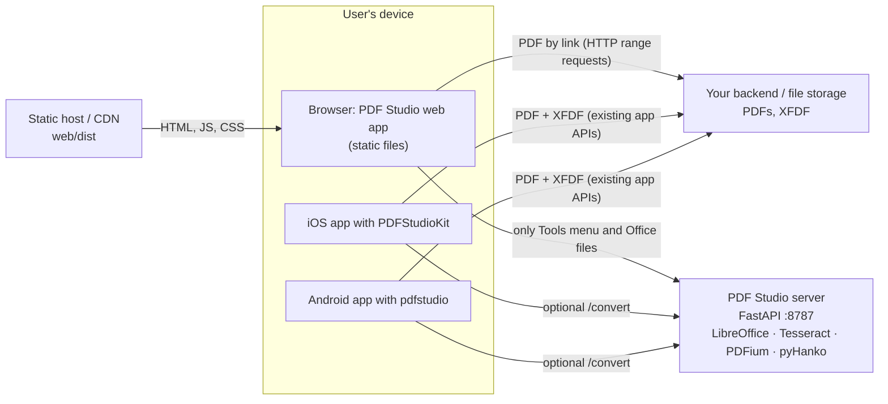

# Server and deployment

**For DevOps and release engineers.** What runs where, how to set it up, how to release the web app and the server, how to check a release and how to roll back.

> **What has been tested.** The web dev server (`npm run dev`) and the server on `127.0.0.1:8787` (`./run.sh`) are used every day in development. The sections on hosting describe the **intended** setup. The Docker image has **not yet been built and run** by the maintainers: build and test it once before relying on it (§4). The Ubuntu scripts below are syntax-checked but have not been run on a real server yet.

## 0. Quick start

### On your computer

```bash
scripts/start-local.sh            # web app http://localhost:5173 + server; Ctrl-C stops both
scripts/start-local.sh --built    # the production build instead, on http://localhost:4173
scripts/start-local.sh --web-only # without the server (Tools menu and Office files disabled)
```

Needs Node.js 22+ and Python 3.12+. For OCR and Office files, install the tools once (macOS: `brew install tesseract tesseract-lang` and `brew install --cask libreoffice`).

Check: open the address, click **Try a sample document**, open **Tools**: it says *Server connected* with a green dot.

### On a test server (Ubuntu, without Docker)

A small Ubuntu 24.04 machine (2 vCPU, 4 GB RAM is enough to test) with ports 80 / 443 open to your own network only.

1. Copy `deploy/ubuntu/` to the server and run it once:

   ```bash
   scp -r deploy/ubuntu ubuntu@SERVER:/tmp/pdf-studio-setup
   ssh ubuntu@SERVER sudo bash /tmp/pdf-studio-setup/setup-server.sh SERVER
   ```

   It installs nginx, Python, LibreOffice (no GUI), Tesseract (English + Hindi) and fonts. It also creates the `pdfstudio` user, `/opt/pdf-studio`, `/var/lib/pdf-studio`, `/etc/pdf-studio/server.env`, the `pdf-studio-server` service and the nginx site (web app at `/`, server at `/pdf-api/`).
2. From your computer, deploy (repeat for every new version):

   ```bash
   deploy/deploy.sh ubuntu@SERVER
   ```

   This builds the web app locally (the server needs no Node.js), copies it and `server/`, installs the Python packages, restarts the service, and prints `/pdf-api/health`.
3. Add HTTPS before any real document goes through it:

   ```bash
   ssh ubuntu@SERVER "sudo apt-get install -y certbot python3-certbot-nginx && sudo certbot --nginx -d SERVER"
   ```

4. Before anyone outside your network can reach it, put authentication in front of `/pdf-api/` (the commented `auth_basic` lines in `/etc/nginx/sites-available/pdf-studio`, or your SSO proxy).

**Rollback:** check out the previous commit locally and run `deploy/deploy.sh` again. Nothing on the server holds data except the development signing certificate in `/var/lib/pdf-studio`.

**Logs:** `sudo journalctl -u pdf-studio-server -f`, and `/var/log/nginx/`.

**Test it:** run the Postman collection ([API testing](api-testing.md)) with `baseUrl` set to `https://SERVER/pdf-api`.

## 1. What runs where



| Component | What it is | Needs a server? | State it keeps |
|---|---|---|---|
| **Web app** | Static site built from `web/` (`web/dist`) | Only a static host | Autosave in each user's browser (localStorage) |
| **PDF Studio server** | Python 3.12 + FastAPI in `server/` | Yes, if Tools / Office files are wanted | None: each request works in a temporary folder that is deleted afterwards. Only the development signing certificate is written to `PDFSTUDIO_DATA_DIR` |
| **iOS / Android SDKs** | Libraries inside your iOS / Android apps ([mobile SDKs](mobile-sdks.md)) | No (server optional for Office files) | None of their own |
| **React viewer component** | `packages/react-viewer` (`@pdf-studio/react-viewer`), built into your React app | No | None: the host app saves XFDF / PDFs through its own backend ([migrating from PDFTron](migrating-from-pdftron.md#web-webviewer--pdftronwebviewer)) |

## 2. The web app

### Build

```bash
cd web
npm ci
npm run i18n:check -- --strict     # every screen text translated (fails otherwise)
npm run build                      # type-check + production bundle → web/dist
```

Build-time settings (environment variables at `npm run build`):

| Variable | Default | Purpose |
|---|---|---|
| `VITE_PDFSTUDIO_SERVER` | `http://localhost:8787` | Address of the PDF Studio server. Users can override it in *Tools ▸ Server address* (stored in their browser). |
| `VITE_PDFSTUDIO_FILE_ORIGINS` | *(empty)* | Comma-separated origins, besides the app's own, from which `?file=` and *Open from link…* may load PDFs, e.g. `https://files.example.com,https://cdn.example.com`. |

### Host

`web/dist` is plain static files. Any static host or CDN works (S3 + CloudFront, Nginx, an existing web server). Requirements:

- Serve `index.html` for `/`. There are no other routes.
- Serve `.mjs` files as `text/javascript`. The PDF.js worker is an `.mjs` file in `assets/`.
- Long cache for `assets/*` (file names contain a content hash); no cache or a short one for `index.html`.
- HTTPS.

### PDFs opened by link (large files)

For page-by-page loading, the server that **stores the PDFs** must support HTTP range requests:

- respond `206 Partial Content` to `Range: bytes=…` and send `Accept-Ranges: bytes` (S3, CloudFront and Nginx do this by default);
- if the PDFs are on another origin than the web app, its CORS must allow the app's origin and **expose** `Accept-Ranges, Content-Range, Content-Length`, and allow the `Range` request header.

Without range support the file still opens, but only after it has fully downloaded.

Optimising stored PDFs with the server's `/optimize` (linearize) makes the first page appear sooner on slow networks. This can be done in bulk, from a script calling the endpoint for each file.

## 3. The server on a Mac (development)

```bash
brew install tesseract tesseract-lang          # OCR + 160 languages incl. Hindi
brew install --cask libreoffice                # Office conversion
cd server
./run.sh                                       # http://127.0.0.1:8787 (creates .venv the first time)
.venv/bin/python -m pytest -q                  # server test suite
```

Check: `curl http://127.0.0.1:8787/health` shows `"ok": true` and each feature `true`. In the web app, *Tools* shows a green dot.

## 4. The server with Docker (servers)

```bash
cd server
docker build -t pdf-studio-server:0.5.0 .
docker run -d --name pdf-studio -p 8787:8787 \
  -e PDFSTUDIO_ALLOWED_ORIGINS=https://pdf.example.com \
  -e PDFSTUDIO_SIGN_P12=/certs/org-signer.p12 \
  --env-file /secure/pdfstudio-secrets.env \
  -v /secure/certs:/certs:ro -v pdfstudio-data:/home/pdfstudio/data \
  pdf-studio-server:0.5.0
```

*Template:* host names and paths are placeholders. `pdfstudio-secrets.env` holds one line, `PDFSTUDIO_SIGN_P12_PASSWORD=…`, written by your secret manager. Never put the password on the command line or in the repository.

The image contains LibreOffice (no GUI), Tesseract with English and Hindi, and Noto fonts, so Devanagari, CJK and other scripts convert correctly. For more OCR languages, add packages such as `tesseract-ocr-mar`, `-guj`, `-ben` or `-ara` to the Dockerfile.

The image runs 2 Uvicorn workers. The per-tool concurrency limits (convert 2, OCR 1, redact 2, sign 4, optimize 2, extract 2) apply **per worker**. Size the machine for that: OCR uses one CPU core per page being processed.

**Not done yet:** building this image and running the test suite inside it. Before the first deployment, run `docker build`, then `docker run … python -m pytest` with the tests copied in (or run the API collection, see [API testing](api-testing.md), against the container). Record the result.

## 5. Configuration (server)

| Variable | Default | Purpose |
|---|---|---|
| `PDFSTUDIO_ALLOWED_ORIGINS` | `http://localhost:5173,http://localhost:5178,http://127.0.0.1:5173` | Comma-separated web origins allowed by CORS. Set to the web app's origin(s) in every real environment |
| `PDFSTUDIO_MAX_UPLOAD_MB` | `100` | Upload limit per request |
| `PDFSTUDIO_SOFFICE` | auto-detected | Path to LibreOffice `soffice` |
| `PDFSTUDIO_TESSERACT` | auto-detected | Path to `tesseract` |
| `PDFSTUDIO_CONVERT_TIMEOUT` | `180` | Seconds before a conversion is stopped |
| `PDFSTUDIO_OCR_DPI` | `300` | Rendering resolution for OCR |
| `PDFSTUDIO_REDACT_DPI` | `200` | Resolution of redacted pages (higher = sharper, larger) |
| `PDFSTUDIO_SIGN_P12` | — | PKCS#12 file with the organisation's signing certificate and key |
| `PDFSTUDIO_SIGN_P12_PASSWORD` | — | Its password (secret) |
| `PDFSTUDIO_TSA_URL` | — | RFC 3161 timestamp server; enables PAdES B-T |
| `PDFSTUDIO_TRUST_ROOTS` | — | PEM bundle of extra trusted roots for `/verify` |
| `PDFSTUDIO_DATA_DIR` | `server/data` | Where the development certificate is created and kept |

## 6. API summary

All endpoints take `multipart/form-data`. PDF results come back as `application/pdf`, with a base64-encoded JSON report in the `X-PDFStudio-Report` header. **Every error** is `{"error": "message"}` with a 4xx or 5xx status. Full request and response details, test cases and the Postman collection are in [API testing](api-testing.md).

| Endpoint | Does | Built on |
|---|---|---|
| `GET /health` | Version, available features, OCR languages, signer, upload limit | — |
| `POST /convert` | Office / HTML / text → PDF | LibreOffice |
| `POST /ocr` | Invisible text layer on scanned pages | PDFium + Tesseract + pikepdf |
| `POST /redact` | True redaction of areas and exact words, optional cleaning and re-OCR | PDFium + Pillow + pikepdf |
| `POST /sign` | PAdES signature (visible, in a field, invisible, certify) | pyHanko |
| `POST /verify` | Checks every signature: intact, trusted, coverage | pyHanko |
| `POST /optimize` | Linearize ("fast web view"), recompress, optionally downsample images; refuses signed files | pikepdf + Pillow |
| `POST /extract` | Text with positions and fonts, embedded images, font list and font files (JSON, ZIP or plain text) | PDFium + pikepdf + Pillow |
| `GET /certificate.pem` | The current signing certificate | — |

## 7. Signing certificates

Without `PDFSTUDIO_SIGN_P12`, the server creates a **self-signed development certificate** in `PDFSTUDIO_DATA_DIR` on first use. Signatures made with it are cryptographically sound and tamper-evident. But Acrobat, Chrome and other readers report the signer as *unknown* or *not trusted*, because no certificate authority vouches for it. The web app warns about this when signing.

For production, use one of these:

- a **document-signing certificate** from a CA on the Adobe Approved Trust List (AATL);
- the organisation's internal CA, with its root installed on staff machines (internal documents only);
- a national **eSign / qualified-signature** provider (for example an Indian eSign / DSC provider or an EU qualified trust service) that issues PKCS#12, or a remote-signing API (pyHanko also supports PKCS#11 tokens and HSMs; these need code in `server/app/signing.py`).

Keep the `.p12` and its password outside the repository, in a secrets manager or a read-only mounted volume. Mount `PDFSTUDIO_DATA_DIR` as a volume, or set `PDFSTUDIO_SIGN_P12`. Otherwise each new container (and possibly each worker on first start) makes its own development certificate.

## 8. Releasing

### Before the release (checklist)

- [ ] Version decided (server version is in `server/app/main.py`, `FastAPI(version=…)`; the web app has no version number yet: use the build date and the source snapshot).
- [ ] `cd web && npx tsc -b && npm run lint && npm run i18n:check -- --strict` pass.
- [ ] `cd server && .venv/bin/python -m pytest -q` passes.
- [ ] iOS `swift test` and Android unit tests pass ([mobile SDKs](mobile-sdks.md)) if the SDKs changed.
- [ ] Manual check of the main web flows on this build (open, annotate, save, forms, pages, Tools); no open P1 bug.
- [ ] API collection ([API testing](api-testing.md)) passes against the build of the server being released.
- [ ] `PDFSTUDIO_ALLOWED_ORIGINS`, `VITE_PDFSTUDIO_SERVER` and `VITE_PDFSTUDIO_FILE_ORIGINS` are set for the target environment.
- [ ] Previous web build and previous server image kept, for rollback (below).
- [ ] Third-party notices current: the web build regenerates its own; after a server or Android dependency change, run `server/.venv/bin/python scripts/gen_third_party_notices.py` from the repository root.

### Deploy the server

1. Build and tag the image with the version: `docker build -t pdf-studio-server:<version> server/`.
2. Start the new container next to the old one on another port, or in a new task / pod, with the same environment.
3. **Check** the new container: `GET /health` → `ok: true`, `version` = the new version, and the expected features `true`. Then run the Postman collection against it ([API testing](api-testing.md)): all P1 requests pass.
4. Switch traffic (load balancer target, reverse-proxy upstream, or the port mapping).
5. **Check again** through the public address: `/health`, and one OCR and one sign request from the web app.
6. Keep the old container stopped but not removed until the next release.

**Stop and roll back** if `/health` fails, any P1 API test fails, or error rates rise after the switch.

### Deploy the web app

1. `npm run build` with the environment's variables.
2. Upload `web/dist/assets/*` first (new hashed names, so nothing old breaks), then `index.html`.
3. Invalidate the CDN cache for `/index.html` only.
4. **Check:** open the site in a private window; *Try a sample document*; annotate and download; *Tools* shows a green dot (if a server is used); switch to Arabic and back.

### Roll back

| What | How | Notes |
|---|---|---|
| Web app | Put the previous `index.html` back (the old `assets/*` files are still there) and invalidate `/index.html` | Users' autosaved annotations are in their browsers and are not affected |
| Server | Route traffic back to the previous image / container | The server keeps no data, so nothing needs migrating back |
| Signing certificate | Restore the previous `.p12` and password | Documents signed in between remain valid with the certificate that signed them |

There is no database, so there are no migrations and no data rollback.

## 9. Operations

- **Monitoring (recommended, not set up):** call `GET /health` every minute and alert on failure. Watch response times of `/ocr` and `/convert`, 5xx rates, and container memory (LibreOffice and large PDFs can use several hundred MB).
- **Logs:** Uvicorn access logs, plus the `pdfstudio` logger for tool errors. Logs contain file *names* and errors, never file contents. Don't turn on request-body logging in a proxy: uploads are private documents.
- **Capacity:** OCR takes a few seconds per page per CPU core. A 100-page scan on one worker is minutes, not seconds. For big batches, run OCR off-peak or on a separate instance.
- **Security:** run the server in a container or VM (LibreOffice and image decoders process untrusted files). Keep it behind your normal authentication (API gateway or reverse proxy) before exposing it beyond the internal network. Tighten CORS to the real origins.
- **Backups:** nothing to back up except the signing certificate and its password (in the secret manager).

## 9a. Changes by version

| Version | Change | Action when upgrading |
|---|---|---|
| 0.5.0 | New `POST /extract`. **Fix:** `/redact` now cleans hidden information when `sanitize` is left out, as documented (before, leaving it out turned cleaning off; the web app always sent it, so only direct API callers were affected). All errors are `{"error": …}`. A mistyped `PDFSTUDIO_SOFFICE` now shows `convert: false` in `/health` | API callers that relied on omitting `sanitize` to keep metadata must now send `sanitize=false` |
| 0.4.0 | New `POST /optimize` | — |

## 10. Licences of server components

| Component | Licence | How it's used |
|---|---|---|
| FastAPI, Uvicorn, Pillow, pyHanko | MIT / BSD / HPND | Libraries |
| pypdfium2 / PDFium | Apache-2.0 / BSD-3 | Library |
| pikepdf / qpdf | MPL-2.0 / Apache-2.0 | Library, unmodified |
| Tesseract | Apache-2.0 | Separate program |
| LibreOffice | MPL-2.0 | Separate program |

The OCR pipeline does **not** use Ghostscript (AGPL) or OCRmyPDF.
